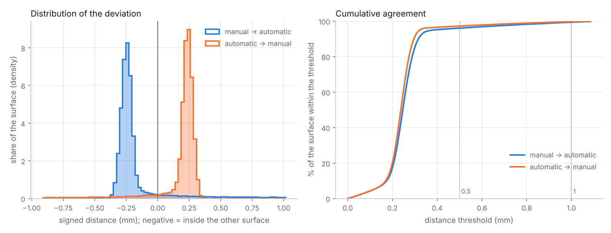

# Test HDR
# stl-deviation

Quantify and visualise how far two triangulated surfaces (STL) are from each other.

Typical use: compare a **manual** segmentation with an **automatic** one of the same
structure, a **morphed** model with a patient-specific one, or a student's model with a
reference, and answer *"how close are they, where do they differ, and in which direction?"*



*Synthetic demo: the "manual" surface is slightly smaller than the "automatic" one (blue peak
on the negative side) with one locally over-segmented bump (the long tail).*

## What it computes

* **Exact signed point-to-surface distances** in both directions (A→B and B→A), evaluated on
  area-uniform random samples (so the statistics do not depend on how the mesh is triangulated)
  and on every vertex (for colour maps and extremes).
* **ASSD** (average symmetric surface distance), **RMSD**, **Hausdorff distance (HD)**, **HD95**.
* **Share of the surface within tolerances** (default 0.5, 1 and 2 units).
* **Signed bias**: positive means A is on average *outside* B (A larger), negative means inside.
* **Volumes** and relative volume difference (closed meshes).
* Optional **Dice / Jaccard** on a common voxel grid (`--overlap`).
* Optional **alignment** of A onto B (`--align centroid|icp`).
* **Outputs**: `metrics.json`, `metrics.csv` (one row, easy to stack in a spreadsheet),
  `deviation_histogram.png`, and per-vertex colour-mapped `*.vtk` (ParaView, 3D Slicer) and
  `*.ply` (MeshLab, Blender). Blue = inside the other surface, grey = agreement, red = outside.

## Install

```bash
git clone https://github.com/YOUR-ACCOUNT/stl-deviation.git
cd stl-deviation
python -m pip install -e ".[plot]"      # numpy + scipy (+ matplotlib for the figure)
```

Python 3.9 or later. No compiled dependency, no GPU.

## Quick start

```bash
python examples/demo.py                                    # synthetic data, nothing to download

stl-deviation manual.stl automatic.stl \
    --name-a manual --name-b ai --units mm \
    --tolerances 0.5 1 2 --overlap --out results/
```

Démarrage rapide (FR) : `stl-deviation manuelle.stl ia.stl --name-a manuelle --name-b ia --out resultats/`.
Les STL doivent être dans le même repère (c'est le cas de deux segmentations d'un même DICOM) ;
sinon utiliser `--align icp`. Les unités sont celles des STL (généralement le mm).

From Python:

```python
from stl_deviation import read_stl, compute_deviation, summarize

a, b = read_stl("manual.stl"), read_stl("automatic.stl")
metrics = summarize(compute_deviation(a, b), tolerances=(0.5, 1, 2), units="mm")
print(metrics["symmetric"]["assd"], metrics["symmetric"]["hd95"])
```

## Reading the results

| Metric | Meaning |
|---|---|
| `assd` | typical distance between the two surfaces (mean of the two directions) |
| `hd95` | distance that 95 % of the surface stays under: robust "worst case" |
| `hd` | largest distance anywhere: sensitive to a single spike |
| `a_to_b.mean_signed` | bias: > 0 A is larger than B, < 0 A is smaller than B |
| `within_tolerance` | share of the surface closer than each threshold |

Always choose the tolerance from the application (voxel size of the CT/MRI, clinical or
mechanical requirement), not from the result.

## Good to know

* **Do not align** two segmentations of the same image: they already share a coordinate system,
  and alignment would hide a systematic offset. `--align` is for models from different sources.
* **Signed distances need closed, consistently oriented surfaces.** For an open surface (e.g. a thin
  membrane or an orbital floor modelled as a shell) distances are reported unsigned and a warning
  is added to the report.
* **Dice depends on the voxel size**, and is unreliable for structures only a few voxels thick.
  Report the voxel size with any Dice, and rely on the surface distances for thin structures.
* STL files carry no unit: `--units` only labels the output.
* The nearest triangle is searched among the 32 closest centroids and then measured exactly; this
  matched brute force in the tests. Raise `k` in `compute_deviation` for very elongated triangles.
* **Never commit patient-derived STL or DICOM files.** `.gitignore` excludes them by default.

## Tests

```bash
python -m pip install -e ".[dev]"
python -m pytest
```

The suite checks the geometry against brute force and against analytic cases (concentric and
translated spheres, the volume of the lens formed by two overlapping spheres for Dice, recovery
of a known rigid motion by ICP).

## Citing

If you use this software, please cite it (see `CITATION.cff`; GitHub shows a "Cite this repository"
button). A DOI is minted for each release through Zenodo.

## License

MIT, see `LICENSE`.
